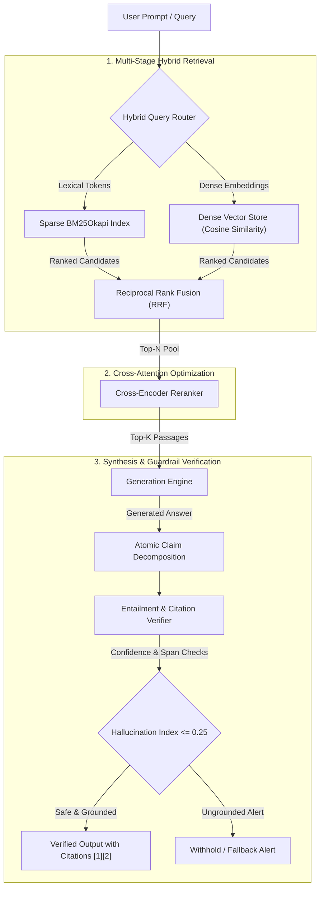

# VeriRAG: Self-Correcting RAG with Hallucination Guardrails

[](https://github.com/verirag/verirag/actions)
[](https://www.python.org/downloads/)
[](LICENSE)
[](https://fastapi.tiangolo.com)
[](docker/Dockerfile)

> Production-grade retrieval-augmented generation engine integrating **Hybrid Search (BM25 + Dense Vectors)**, **Reciprocal Rank Fusion (RRF)**, **Cross-Encoder Reranking**, and an automated **Hallucination Verification Guardrail**.

---

## Architecture Overview



---

## Core Capabilities

1. **Hybrid Retrieval with Reciprocal Rank Fusion (RRF):**
   Combines token-frequency BM25 lexical search with dense vector embeddings using monotonic reciprocal rank fusion:
   $$\text{RRF}(d) = \sum_{m \in M} \frac{1}{k + r_m(d)}$$
   Eliminates the keyword-miss problem common to pure vector search while retaining deep semantic relevance.

2. **Two-Stage Cross-Encoder Reranking:**
   Employs all-to-all cross-attention scoring between query terms and candidate passages, filtering out false-positive embeddings before context reaches the LLM.

3. **Hallucination Guardrails & Citation Verification:**
   Decomposes synthesized responses into atomic factual statements, verifies each claim against source context spans using natural language inference heuristics, and injects verifiable bracketed citation references `[1]`, `[2]`.

4. **Built-In RAG Triad Evaluator:**
   Automated evaluation metrics measuring **Context Precision**, **Context Recall**, **Faithfulness**, and **Answer Relevance** without requiring external SaaS accounts.

5. **Production Ready:**
   Full FastAPI REST API, typed Pydantic V2 schemas, rich command-line interface, containerized Docker deployment, and GitHub Actions CI.

---

## Quickstart

### 1. Installation

```bash
git clone https://github.com/<your-username>/verirag.git
cd verirag

python -m venv venv
source venv/bin/activate  # On Windows: venv\Scripts\activate

pip install -r requirements.txt
```

### 2. Ingest Sample Knowledge Base

```bash
python -m verirag.cli ingest sample_data/enterprise_docs/
```

### 3. Ask Questions with Verified Citations

```bash
python -m verirag.cli query "How does Raft leader election handle split votes?"
```

Output:
```text
--- Verified Answer ---
Raft uses randomized election timers typically between 150ms and 300ms to avoid split votes [1].

--- Hallucination Guardrail Report ---
  Total Claims:         1 (Verified: 1, Unsupported: 0)
  Faithfulness Score:   100.0%
  Hallucination Index:  0.000
  Verification Status:  SAFE
```

### 4. Run Automated Evaluation Benchmarks

```bash
python -m verirag.cli benchmark --dataset sample_data/eval_gold_dataset.json
```

---

## REST API Reference

Launch the server:
```bash
python -m verirag.cli serve --host 127.0.0.1 --port 8000
```
Interactive Swagger docs: `http://127.0.0.1:8000/docs`

### Ingest Documents
`POST /api/v1/documents/ingest`
```bash
curl -X POST http://127.0.0.1:8000/api/v1/documents/ingest \
  -H "Content-Type: application/json" \
  -d '{
    "document_id": "doc_01",
    "content": "Zero Trust mandates mutual TLS and short-lived ephemeral certificates."
  }'
```

### Execute Verified Query
`POST /api/v1/query`
```bash
curl -X POST http://127.0.0.1:8000/api/v1/query \
  -H "Content-Type: application/json" \
  -d '{
    "query": "What are the authentication requirements under Zero Trust?",
    "top_k": 3,
    "enable_reranking": true,
    "enable_verification": true
  }'
```

---

## Docker Deployment

Run with Docker Compose:
```bash
docker compose -f docker/docker-compose.yml up --build -d
```
Check health:
```bash
curl http://localhost:8000/health
```

---

## Repository Structure

```text
verirag/
├── .github/workflows/ci.yml       # Automated GitHub Actions test workflow
├── docker/
│   ├── Dockerfile                 # Production multi-stage container build
│   └── docker-compose.yml         # Containerized orchestration
├── sample_data/
│   ├── enterprise_docs/           # Standard technical documentation corpus
│   └── eval_gold_dataset.json     # Ground-truth evaluation dataset
├── tests/                         # Full Pytest unit and integration suite
├── verirag/
│   ├── api/                       # FastAPI application & Pydantic schemas
│   ├── core/
│   │   ├── bm25.py                # Pure Python BM25Okapi lexical index
│   │   ├── chunking.py            # Recursive markdown text splitter
│   │   ├── embeddings.py          # Modular embedding providers
│   │   ├── evaluator.py           # RAG triad evaluation engine
│   │   ├── generator.py           # Prompt formatting & synthesis
│   │   ├── hallucination_guard.py # Claim decomposition & verification
│   │   ├── hybrid_retriever.py    # Reciprocal Rank Fusion engine
│   │   ├── reranker.py            # Two-stage cross-encoder
│   │   └── vector_store.py        # Persistent vector store
│   ├── cli.py                     # Rich command-line interface
│   └── config.py                  # Pydantic configuration loader
├── pyproject.toml                 # Package configuration
└── requirements.txt               # Dependencies
```

---

## License

This project is open-source under the MIT License.
