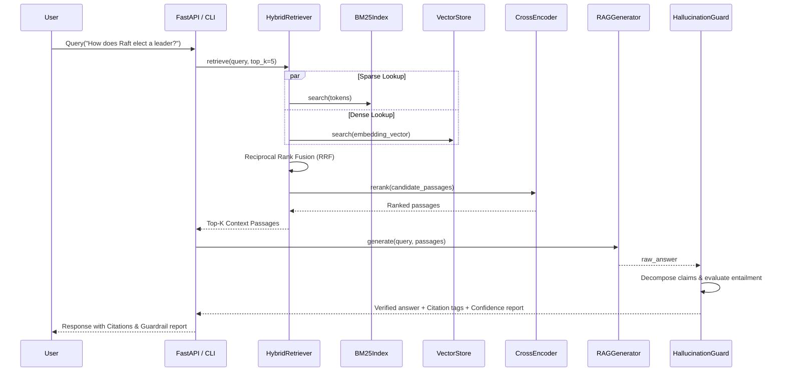

# VeriRAG Architecture Specification

## 1. System Pipeline

## 2. Ingestion Mechanics
1. **Document Loading:** Ingests raw markdown or text.
2. **Recursive Splitting:** Employs hierarchical separators (`\n## `, `\n### `, `\n\n`, `\n`, `. `, ` `) respecting logical section boundaries.
3. **Dual Indexing:** Simultaneously populates the sparse inverted index with normalized term frequencies and the dense vector store with normalized embeddings.

## 3. Grounding Verification Algorithm
- Each statement $S_i$ in the output is scored against each retrieved passage $C_j$:
  $$\text{EntailmentScore}(S_i, C_j) = \frac{|\text{Tokens}(S_i) \cap \text{Tokens}(C_j)|}{|\text{Tokens}(S_i)|} + \text{N-GramBonus}$$
- If $\max_j \text{EntailmentScore}(S_i, C_j) \ge \tau$, the claim is tagged as `VERIFIED` and attributed to passage index $j$.
- If the overall `HallucinationIndex` exceeds 0.25, the system raises a safety flag.
